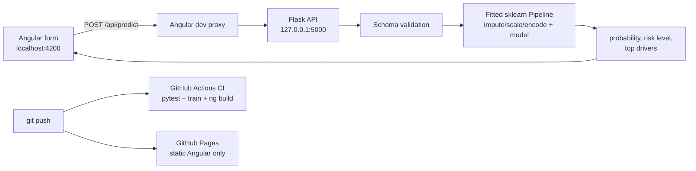
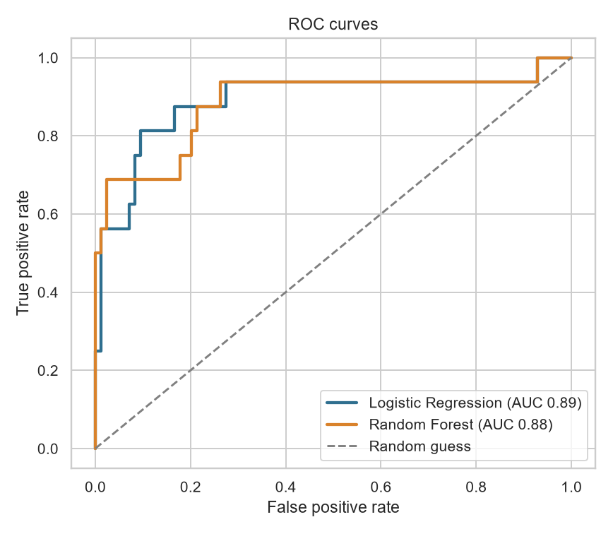
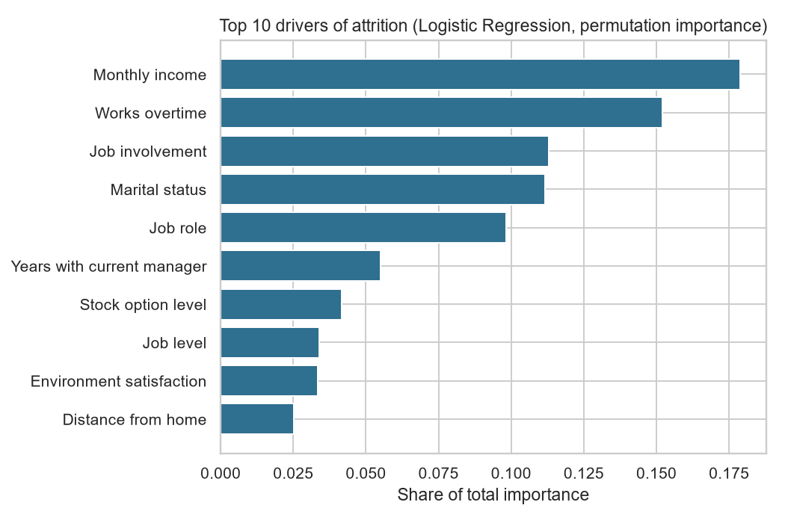

# Attrition Risk Console

**An end-to-end MLOps project:** train and package an employee-attrition model, serve it through a validated Flask REST API, use it from an Angular dashboard, and test, build and publish everything automatically with GitHub Actions.

[](https://github.com/YOUR_USERNAME/YOUR_REPO/actions/workflows/ci.yml)
[](https://github.com/YOUR_USERNAME/YOUR_REPO/actions/workflows/pages.yml)

| | |
|---|---|
| **Live static demo (GitHub Pages)** | https://YOUR_USERNAME.github.io/YOUR_REPO/ |
| **Repository** | https://github.com/YOUR_USERNAME/YOUR_REPO |
| **Task** | Binary classification: will an employee leave (`Attrition` = Yes/No)? |
| **Data** | IBM HR Analytics Employee Attrition (public), stratified sample of 500 rows, 30 raw features |
| **Champion model** | Logistic Regression pipeline (test ROC-AUC 0.89, recall on leavers 0.88) |

> **Deployment boundary.** GitHub Pages serves static files only. The public site shows the dashboard and live model card, but the prediction button is intentionally disabled there. Predictions run when Flask and Angular run locally (or on a separately hosted backend, see the Dockerfile).

## Architecture



## What makes this more than a notebook

- **One fitted Pipeline.** Scaling and one-hot encoding live inside the pipeline, so the API accepts the *raw* 30 form values. No preprocessing is refitted at prediction time.
- **Honest model selection.** Both models are tuned with 5-fold stratified cross-validation on the training split only. The champion is chosen on CV ROC-AUC, never on the test set.
- **Single source of truth.** `ml/train.py` writes the model bundle, the API schema and the Angular `feature-schema.ts`, so frontend and backend cannot drift apart.
- **Defensive API.** Rejects missing or extra fields, wrong types, out-of-range numbers and unknown categories with clear 400 errors.
- **Explainable result.** Every prediction returns the five factors that moved the estimate most (model-agnostic what-if against typical values).
- **12 automated API tests** plus CI that retrains the model from scratch and re-runs the tests.

## Project structure

```
backend/        Flask API, tests, model bundle, helper scripts
  app.py  make_payload.py  test_pipeline.py  test_api.py  requirements.txt
  models/model_bundle.joblib      fitted pipeline + feature list + schema
  tests/                           pytest suite (12 tests)
ml/train.py     reproducible training, evaluation, charts, schema export
data/           HR dataset + non-sensitive sample record
frontend/       Angular app (proxy.conf.json, feature-schema.ts generated)
docs/           technical report, model report, charts, environment record
.github/workflows/  ci.yml, pages.yml
Dockerfile  run_local.ps1  .vscode/tasks.json
```

## Run it locally (Windows, PowerShell)

Prerequisites: Python 3.12, Node.js 22 LTS or newer, Git. Versions used are in `docs/environment.txt`.

```powershell
# 1. Backend environment
py -3.12 -m venv .venv
.\.venv\Scripts\Activate.ps1
python -m pip install -r backend\requirements.txt

# 2. (Optional) retrain: regenerates model, charts, schema, report
python ml\train.py

# 3. Verify the model, then the API tests
python backend\make_payload.py
python backend\test_pipeline.py          # expect: PASS: local inference
python -m pytest -q backend\tests        # expect: 12 passed

# 4. Terminal 1 - Flask (keep open)
python backend\app.py                    # http://127.0.0.1:5000/health

# 5. Terminal 2 - Angular (keep open)
cd frontend
npm ci
npm start                                # ng serve with the proxy; http://localhost:4200

# 6. Terminal 3 - extra checks
curl.exe --noproxy "*" -i http://localhost:4200/api/health
python backend\test_api.py               # needs Flask running
```

Shortcut: `.\run_local.ps1` does steps 1, 4 and 5 for you.

## API

| Method | Path | Purpose |
|---|---|---|
| GET | `/health` | Liveness, model name and version, feature count |
| GET | `/schema` | Names, types, ranges and allowed categories of all 30 inputs |
| GET | `/report` | Training metrics and top features |
| POST | `/predict` | JSON with all 30 raw features, returns prediction, `probability_leave`, `risk_level`, `drivers` |

Risk bands on the leaving probability: **Low** below 0.35, **Medium** 0.35 to 0.60, **High** from 0.60.

## Results (held-out test set, 100 employees)

| Metric | Logistic Regression | Random Forest |
|---|---|---|
| Accuracy | 0.830 | 0.840 |
| ROC-AUC | **0.890** | 0.885 |
| Cross-validated ROC-AUC | **0.778** | 0.758 |
| Recall on leavers | **0.875** | 0.688 |
| Precision on leavers | 0.483 | 0.500 |
| Train minus test accuracy | -0.037 | +0.033 |

Neither model overfits (gaps are small). Logistic Regression wins on cross-validation and catches more leavers, which matters most for retention work. Charts are in `docs/charts/`; the full write-up is in [`docs/TECHNICAL_REPORT.md`](docs/TECHNICAL_REPORT.md).




## CI/CD

- **`ci.yml`** runs on every push and pull request: installs pinned dependencies, runs all backend tests, retrains the model end-to-end, re-tests, and builds Angular (uploading both as artifacts).
- **`pages.yml`** builds Angular for production and deploys `frontend/dist/frontend/browser` to GitHub Pages. The `--base-href` is taken from the repository name automatically.
- One-time setup: GitHub repo, **Settings, Pages, Source: GitHub Actions**.

## Docker (optional hosted backend)

```bash
docker build -t attrition-api .
docker run -p 5000:5000 attrition-api
```

## Troubleshooting

| Symptom | Fix |
|---|---|
| `node` / `ng` not recognized | Close all VS Code windows, reopen, new terminal. Try `ng.cmd`. |
| PowerShell blocks `Activate.ps1` | `Set-ExecutionPolicy -Scope Process -ExecutionPolicy RemoteSigned` |
| Angular shows "Cannot reach the Flask API" | Start Flask first; start Angular with `npm start` (uses `proxy.conf.json`) |
| `/api/health` returns 404 | Angular was started without the proxy. Restart with `npm start`. |
| HTTP 502 on localhost from Python | `requests.Session()` with `trust_env = False` (already in `test_api.py`) |
| Pages shows a blank page or 404 | Pages source must be GitHub Actions; check the deploy log and base-href |
| Pickle load error | Use the pinned versions in `backend/requirements.txt` |

## Limitations and ethics

The model is trained on 500 employees from a public, partly synthetic dataset and evaluated on 100, so scores carry wide uncertainty (cross-validated AUC 0.78 is the more cautious estimate). Precision on leavers is about 0.5: roughly half of the people flagged will not actually leave. Use it as a conversation starter for retention support, never to penalise or select individuals. Protected attributes such as age, gender and marital status are in the data; a production system would need a fairness review.
github user_name="231998-Laiba" and repo:employee_attrition_prediction_performance