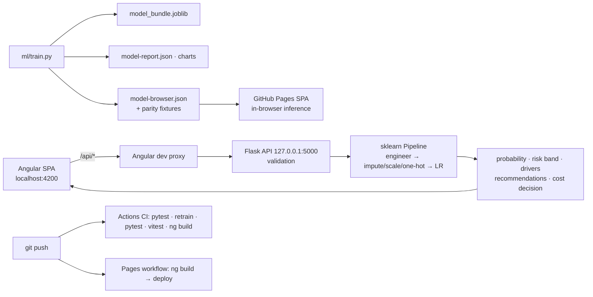

# Attrition Risk Console

**Leakage-free reproduction of a published employee-attrition study, extended from *prediction* to *decision*, and shipped as a tested full-stack application.**
scikit-learn pipeline → Flask REST API → Angular 21 dashboard → GitHub Actions CI → GitHub Pages (with in-browser predictions).

[](https://github.com/231998-Laiba/employee_attrition_prediction_performance/actions/workflows/ci.yml)
[](https://github.com/231998-Laiba/employee_attrition_prediction_performance/actions/workflows/pages.yml)

| | |
|---|---|
| **Live site (GitHub Pages)** | https://231998-laiba.github.io/employee_attrition_prediction_performance/ |
| **Repository** | https://github.com/231998-Laiba/employee_attrition_prediction_performance |
| **Reproduced paper** | Pratama, Fatchan & Hadikristanto (2024). *Improving Employee Retention Through Prediction and Risk Management Using Machine Learning.* IJARSS 2(6), 475–484. [doi:10.59890/ijarss.v2i6.1960](https://doi.org/10.59890/ijarss.v2i6.1960) |
| **Task** | Binary classification: will an employee leave (`Attrition` = Yes/No)? |
| **Data** | IBM HR Analytics Employee Attrition & Performance: all 1,470 employees (237 leavers, 16.1%), 30 raw inputs + 7 paper-engineered features |
| **Champion** | L1-regularised Logistic Regression in one fitted sklearn `Pipeline` (model v2.0.0) |
| **Headline (honest)** | Test accuracy **88.8%** (95% CI 85.0–92.2%), nested-CV accuracy **88.4% ± 1.3%**, test ROC-AUC **0.822**, nested-CV ROC-AUC **0.834** |

> **Deployment boundary (lab manual Stage 14).** GitHub Pages serves static files only and never runs Python. The live site predicts with a JSON export of the fitted pipeline that runs in the browser. Automated parity tests show it matches the Python pipeline to within 1e-9. Locally, the same UI calls the Flask API through the Angular dev proxy. The badge in the top bar shows which engine is active.

---

## 1. Research results

### 1.1 Reproducing the paper: method
`ml/train.py` implements the paper's pipeline exactly:
- **Feature merging:** `Education_EducationField`.
- **Six engineered features:** `Avg_Age_in_Department`, `Age_Category`, `Tenure_Ratio`, `Experience_Per_Year`, `Salary_Category`, `HourlyRate_Efficiency`.
- **Cleaning:** drop `EmployeeCount`, `Over18`, `StandardHours` (plus the `EmployeeNumber` ID); median imputation.
- **Encoding and scaling:** one-hot encoding of the categorical columns; `StandardScaler`.
- **Split and models:** 80/20 `train_test_split`; Logistic Regression (`max_iter=1000`) and a default Random Forest.
- **Evaluation:** overall and per department, in the paper's Table 1 layout.

The feature engineering is a fitted transformer (`backend/attrition_features.py`). Department mean ages and salary tertiles are learned from the training rows only.

### 1.2 Reproducing the paper: per-department accuracy

| Per-department accuracy | HR | R&D | Sales | Mean |
|---|---|---|---|---|
| Paper, Random Forest (reported) | 0.994 | 0.979 | 0.983 | **0.977** |
| Our **correct** reproduction, RF | 0.867 | 0.843 | 0.817 | **0.842** |
| Our **leaky** reproduction, RF (oversample before split) | 0.966 | 0.955 | 0.948 | **0.956** |
| Paper, Logistic Regression (reported) | 0.971 | 0.946 | 0.967 | 0.946 |
| Our correct reproduction, LR | 0.867 | 0.868 | 0.854 | 0.863 |

**Finding: leakage audit.** The paper's near-perfect Random Forest scores (accuracy 0.98–0.99, AUC up to 0.997) appear **only** when leavers are oversampled *before* the split. That leakage gives RF an AUC of 0.997. In that protocol, 49% of "test" rows and 98% of test leavers are exact copies of training rows, so the forest is graded on employees it memorised.

The leaky protocol does **not** reproduce the paper's LR figures (leaky LR gets about 0.81, because a linear model cannot memorise duplicates). Those figures remain unexplained.

The paper's discussion also reports LR "precision 0.89, recall 0.67, F1 0.42". These are mutually inconsistent: that precision and recall imply F1 ≈ 0.76. Chart: `docs/charts/8_paper_vs_reproduction.png`.

### 1.3 Optimised, leakage-free models
How they were trained and selected:
- **Preprocessing:** same as the paper.
- **Tuning:** `GridSearchCV` with 5-fold stratified CV (ROC-AUC) on the 1,176 training rows only.
- **Champion selection:** the one-standard-error rule. Among models within one SE of the best CV AUC, the simplest wins. The test set never influences any choice.

| Held-out test set (294 rows) | **Logistic Regression** ★ | Random Forest | Gradient Boosting | Stacking (nested ensemble) |
|---|---|---|---|---|
| CV ROC-AUC (train) | 0.844 ± 0.026 | 0.813 | 0.818 | 0.846 |
| CV accuracy | 0.884 | 0.862 | 0.876 | 0.884 |
| **Test accuracy** | **0.888** | 0.823 | 0.857 | 0.888 |
| Test ROC-AUC | 0.822 | 0.780 | 0.801 | 0.822 |
| PR-AUC | 0.624 | 0.413 | 0.533 | 0.616 |
| Weighted F1 | 0.870 | 0.779 | 0.825 | 0.870 |
| Precision / recall (leavers @0.5) | 0.818 / 0.383 | 0.308 / 0.085 | 0.667 / 0.213 | 0.818 / 0.383 |
| Specificity | 0.984 | 0.964 | 0.980 | 0.984 |
| MCC | 0.511 | 0.087 | 0.321 | 0.511 |
| Train − test accuracy | **+0.009** | +0.071 | +0.071 | +0.035 |

Validity checks:
- **Nested CV (5×2 outer):** accuracy 0.884 ± 0.013, ROC-AUC 0.834 ± 0.030.
- **Bootstrap 95% CI on the test set:** accuracy 0.850–0.922, ROC-AUC 0.742–0.894.
- **Majority-class baseline:** 0.840 accuracy.
- **Old 500-row protocol:** 0.920 test accuracy, but its CV AUC is only 0.799 and the test set has just 100 rows, so that result is noise. The project now uses the full dataset, as the paper does.

### 1.4 Performance target (>90%, never below 75%): honest assessment

| Metric (champion) | Value | vs 75% floor | vs 90% target |
|---|---|---|---|
| Test accuracy | 88.8% | ✅ | ✗ (CI upper bound 92.2%) |
| Nested-CV accuracy | 88.4% | ✅ | ✗ |
| Specificity | 98.4% | ✅ | ✅ |
| Weighted F1 | 87.0% | ✅ | ✗ |
| ROC-AUC (test / nested) | 82.2% / 83.4% | ✅ | ✗ |
| Recall / F1 on leavers @0.5 | 38.3% / 52.2% | ✗ | ✗ |

**Why 90% is not reached without cheating:**
- Only 16% of employees leave. Predicting "stays" for everyone already scores 84%.
- A strongly tuned linear model, three non-linear models and a stacking ensemble all plateau at about 0.83–0.85 AUC under correct validation. That is the information ceiling of these 30 attributes.
- Every route to >95% that we found (oversampling before the split, evaluating on training rows, selecting on the test set) is data leakage, so we report the leakage instead of the inflated number.
- Minority-class recall is a threshold choice. The cost-sensitive threshold below raises recall to 81% at the expense of accuracy.

## 2. Novel contributions (beyond the paper)
1. **Prescriptive retention actions.** For Medium/High-risk employees, the system tests one-change what-if scenarios on HR-controllable factors: overtime, travel, stock options, salary hike, training, work-life balance and job satisfaction. It returns the strongest distinct action per factor, up to three. Protected attributes are never changed. In the UI, **Apply & re-score** shows the effect live (example: 95% → 80% by removing overtime).
2. **Cost-sensitive decisions.** The action threshold minimises expected cost ($15k per missed leaver, $1.5k per intervention, both adjustable). It is chosen from out-of-fold *training* predictions, then validated on the test set:
   - threshold 0.10: **$270k**
   - default 0.50: $441k
   - no action: $705k
   - leavers caught: 81% at 0.10 vs 38% at 0.50
3. **Leakage audit** of the published results (section 1.2): a controlled experiment that explains the paper's Random Forest scores.
4. **Department risk portfolio** (the paper's "risk management" idea): risk bands per department on the held-out set. 24 of 47 actual leavers fall in the Medium/High bands.
5. **Serverless in-browser engine.** The fitted pipeline is exported to JSON and re-implemented in TypeScript. Parity tests run in both pytest and vitest, so the public site gives real predictions.

## 3. Architecture



**Single source of truth.** `ml/train.py` writes all of these together, so they cannot drift apart:
- the Flask bundle;
- the API schema;
- the Angular `feature-schema.ts`;
- the model report used by the dashboards;
- the browser model and its parity fixtures.

## 4. Project structure
```
backend/   app.py (Flask)  attrition_features.py (paper features)  recommendations.py  cost_analysis.py
           make_payload.py  test_pipeline.py  test_api.py  requirements.txt
           models/model_bundle.joblib      tests/ (28 pytest tests incl. parity_fixtures.json)
ml/train.py   replication · leakage audit · tuning · nested CV · cost threshold · exports · charts
data/      IBM HR CSV + one non-sensitive sample record
frontend/  Angular 21 standalone app
           src/app/engine/   browser-model.ts (+ 7 vitest parity tests)
           src/app/sections/ predict · research · novelty      src/app/ui/ SVG charts, directives
           public/model-report.json  public/model-browser.json   proxy.conf.json
docs/      TECHNICAL_REPORT.md  model_report.json  charts/ (9 figures)  environment.txt
.github/workflows/  ci.yml  pages.yml        Dockerfile  render.yaml  run_local.ps1
```

## 5. Run locally (Windows PowerShell)
Prerequisites: Python 3.12+ (developed on 3.14, CI uses 3.12), Node.js 20.19+ or 22 LTS, Git. Recorded versions: `docs/environment.txt`.

```powershell
# 1. Backend environment
py -3.12 -m venv .venv
.\.venv\Scripts\Activate.ps1
python -m pip install -r backend\requirements.txt

# 2. (Optional) retrain: replication, leakage audit, tuning, nested CV, exports (about 4 min)
python ml\train.py

# 3. Verify the model and run the tests
python backend\make_payload.py
python backend\test_pipeline.py              # PASS: local inference
python -m pytest -q backend\tests            # 28 passed

# 4. Terminal 1 - Flask (keep open)
python backend\app.py                        # http://127.0.0.1:5000/health

# 5. Terminal 2 - Angular with proxy (keep open)
cd frontend
npm ci
npm start                                    # http://localhost:4200
npx ng test --watch=false                    # 7 passed (browser-engine parity)

# 6. Terminal 3 - checks through the proxy
curl.exe --noproxy "*" -i http://localhost:4200/api/health
python backend\test_api.py
```
Shortcut: `.\run_local.ps1`. If Flask is not running, the UI falls back to the in-browser engine automatically, and you can switch engines with the badge in the top bar.

## 6. API
| Method | Path | Purpose |
|---|---|---|
| GET | `/health` | Liveness, model name/version, feature count |
| GET | `/schema` | Names, types, ranges and allowed categories of the 30 raw inputs |
| GET | `/report` | Full research report (replication, leakage audit, models, CV, costs) |
| GET/POST | `/cost-analysis` | Optional `replacement_cost`, `intervention_cost`; returns optimal threshold, savings, cost curve |
| POST | `/predict` | 30 raw features. Returns `prediction`, `probability_leave`, `risk_level`, `action_recommended`, `drivers`, `recommendations` |

Validation rejects missing or extra fields, wrong types, out-of-range numbers and unknown categories with clear 400 errors. Risk bands: Low < 0.35 ≤ Medium < 0.60 ≤ High.

## 7. Testing and CI/CD
- **pytest (28):**
  - API positive and negative cases, plus a behavioural sanity check;
  - cost analysis;
  - recommendations: only lower risk, protected attributes excluded, schema-valid, distinct;
  - paper feature formulas and leakage safety (statistics learned from fit data only);
  - report integrity;
  - **Python ↔ browser export parity**;
  - repository structure.
- **vitest (7):** the TypeScript engine reproduces sklearn probabilities to within 1e-6, plus engineered features, validation, recommendations and cost logic.
- **`ci.yml`:** pytest → retrain from scratch → pytest on the fresh bundle → vitest → production `ng build`, with artifacts uploaded.
- **`pages.yml`:** production build with `--base-href /<repo>/`, then deploy to GitHub Pages. One-time setup: Settings → Pages → Source: GitHub Actions.
- **Optional public API:** `render.yaml` + `Dockerfile` (gunicorn). The repository owner must connect it on Render; the Pages site does not need it.

## 8. Limitations and ethics
- One public dataset, and its realism is uncertain. With 237 leavers, minority-class precision is limited.
- The model finds correlations, not causes. Recommendations are model what-ifs, not guarantees.
- Protected attributes (age, gender, marital status) are model inputs. A fairness audit is needed before any real use, and these attributes are never suggested for change.
- Decision support only: never use it as the sole basis for HR decisions, and discuss support with the employee.

Full write-up: [`docs/TECHNICAL_REPORT.md`](docs/TECHNICAL_REPORT.md).
